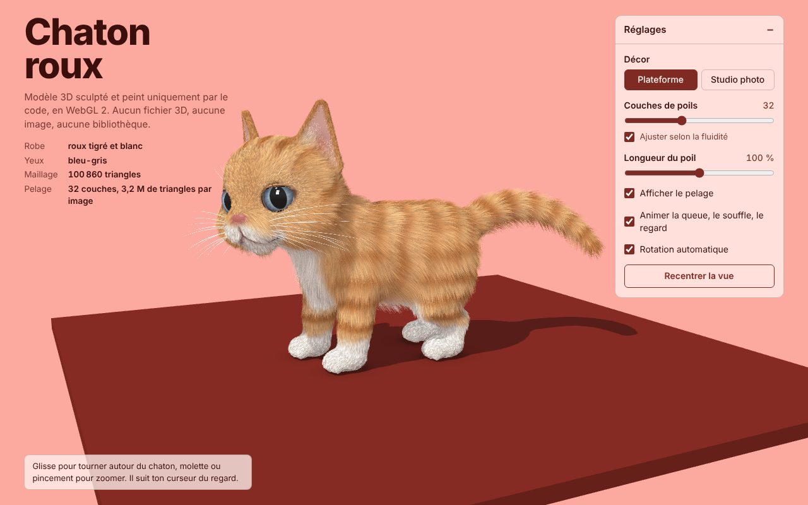

# Chaton roux 3D

site web : [https://alexmoriquand.github.io/website_3d_cat/](https://alexmoriquand.github.io/website_3d_cat/)

Un chaton roux tigré en 3D, avec sa fourrure, qu'on peut faire tourner dans le navigateur. Il est **sculpté et peint uniquement par le code** : pas de fichier 3D, pas d'image, pas de bibliothèque. Juste du JavaScript et du WebGL 2.



## Fonctionnalités

- **Forme modélisée en mathématiques** : le corps est une surface implicite (SDF) faite d'ellipsoïdes et de cônes fondus entre eux, puis transformée en maillage d'environ 100 000 triangles.
- **Fourrure en 3D** : technique des *shells*, où le même maillage est redessiné en 32 couches (ou plus) poussées le long des poils. Le poil est long sur le dos, ras sur le visage et les pattes, et la largeur des brins s'adapte au zoom.
- **Robe peinte sommet par sommet** : roux tigré avec le « M » sur le front, anneaux sur les pattes et la queue, poitrail, museau et chaussettes blancs.
- **Yeux détaillés** : iris bleu-gris fibré, pupille, reflets sur la cornée et paupières qui clignent.
- **Animation** : la queue ondule, le chaton respire, cligne des yeux et suit le curseur du regard.
- **Éclairage** : ombres portées, occlusion ambiante, reflets le long des poils et duvet à contre-jour.
- **Réglages** : décor plateforme ou studio photo, nombre de couches de poils, longueur du poil, pelage visible ou non, animation, rotation automatique.
- **Qualité adaptative** : le nombre de couches baisse automatiquement si l'affichage devient saccadé.

## Lancer le projet

Le projet utilise des modules JavaScript. il faut passer par un petit serveur local.


```bash
npm start                      # avec Node.js
python -m http.server 8000     # avec Python, puis ouvrir http://localhost:8000
```


Il faut un navigateur qui gère WebGL 2 : Chrome, Edge, Firefox ou Safari récent.

## Commandes

| Action | Souris / tactile | Clavier |
| --- | --- | --- |
| Tourner autour | glisser | flèches |
| Zoomer | molette ou pincement | `+` / `-` |
| Recentrer | double-clic | bouton *Recentrer la vue* |

## Structure

```
index.html              page et panneau de réglages
styles/main.css         mise en page
src/
  main.js               WebGL, interface, caméra orbitale, boucle d'affichage
  utils/math.js         vecteurs, matrices, bruit
  kitten/shape.js       forme du chaton (surface implicite)
  kitten/coat.js        couleurs, rayures, longueur et direction des poils
  kitten/mesh.js        maillage par « surface nets »
  kitten/details.js     yeux, moustaches, texture des brins, ombre au sol
  render/shaders.js     shaders GLSL
```

## Comment ça marche

1. **La forme.** `sdf(x, y, z)` renvoie la distance d'un point à la peau du chaton : négative à l'intérieur, positive à l'extérieur. Chaque partie (crâne, joues, oreilles, pattes, queue…) est une forme simple, et `smin` les fond entre elles en douceur.
2. **Le maillage.** On évalue cette fonction sur une grille de 0,18 unité, seulement près de la surface pour aller plus vite. On place un sommet dans chaque cellule traversée par la surface, puis on recale chaque sommet exactement sur la peau.
3. **La peinture.** Pour chaque sommet, `shadeVertex` calcule la couleur (rayures obtenues avec du bruit et des sinus), la longueur et la direction du poil, et l'occlusion ambiante.
4. **La fourrure.** Le maillage est dessiné une fois en instanciation pour chaque couche. Chaque couche est poussée un peu plus loin le long du poil, et le shader ne garde que les pixels qui tombent sur un brin, d'après une texture 3D de points tirés au hasard.
5. **Le rendu.** Il se fait en deux passes : une carte d'ombres vue depuis la lumière, puis l'image (sol, peau, yeux, couches de poils, moustaches).

Le modèle se construit au chargement de la page, ce qui prend une à deux secondes.

## Licence

[MIT](LICENSE)
